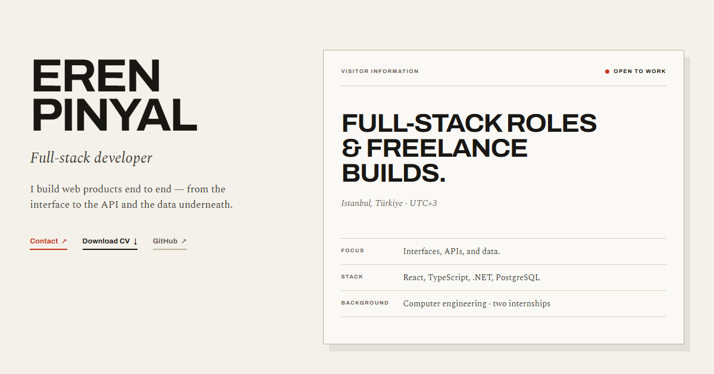

<div align="center">

# Eren Pinyal — Full-Stack Developer

**Kişisel portfolyo ve CV sitesi; eşit kartlardan oluşan bir vitrin değil, küratörlü bir sergi duvarı.**

Dokuz iş, yedi canlı demo, gerçek ürün ekran görüntüleri, EN/TR ve açık/kapalı galeri ışıkları.
React 19 · Vite · Framer Motion · CSS custom properties · Vercel

[](https://erenpinyal.com)
[](https://react.dev)
[](https://vite.dev)
[](https://vercel.com)

[Canlı site](https://erenpinyal.com) · [CV](https://erenpinyal.com/cv.pdf) · [LinkedIn](https://www.linkedin.com/in/eren-pinyal) · [GitHub](https://github.com/erenpinyall)



</div>

## Fikir

Portfolyo bir sergi kataloğu gibi okunur: işler eşit ölçekte asılır, her birinin numarası, durumu, malzemesi ve canlı bağlantısı olan bir duvar etiketi vardır. Kat planı nerede olduğunuzu söyler; dil ve framework panosu teknik genişliği, kronoloji ise iki stajı gösterir. Amaç, ilk ekranda kimlik + kanıt + eylem vermek; süslemek değil.

- **Üst alan:** proje görseli yerine ziyaretçi kartı; uygunluk, İstanbul/UTC+3, odak, stack ve iki staj.
- **Sergi duvarı:** üç sütunlu eşit kart ızgarası; masaüstünde üç, tablette iki, mobilde tek sütun.
- **Duvar etiketleri:** durum (canlı/depo), teknoloji, kısa açıklama, canlı demo ve repo bağlantısı.
- **Gerçek görseller:** yedi canlı iş, ürünlerin ekran görüntüleriyle; iki depo işi elle çizilmiş arayüz etüdüyle gösterilir.
- **Daha fazla:** ilk altı canlı iş açık başlar; Portfolio ve iki depo işi tek düğmeyle açılıp kapanır, böylece sayfa dokuz işin tamamıyla uzamaz.
- **Yetenek panosu:** beş kategori, 64px marka renkli plakalar ve büyük ikonlar; sade listeye göre çok daha görünür.
- **Spotlight:** bir çerçeveye gelince diğerleri 0.52 opaklığa iner; imleç yoksa duvar bütün kalır.
- **Işıklar:** krem galeri (`#F4F1EA`) ile gece modu (`#12100E`) arasında gerçek bir renk inversiyonu; tercih `localStorage`'da kalır.
- **EN/TR:** her metin tek kaynaktan gelir; dil değişince başlık, `lang`, etiketler ve içerik birlikte değişir.
- **Erişilebilirlik:** klavye odağı, `aria-pressed`, `aria-expanded`, `aria-current="location"`, skip link, reduced-motion desteği; Axe'te 0 ihlal.

## Sergideki işler

| # | İş | Ne | Canlı | Kod |
|---|----|----|:-----:|:---:|
| 01 | **Freshy** | 66 ürünlü market ve teslimat demosu | [Aç](https://freshy-five.vercel.app) | [Repo](https://github.com/erenpinyall/freshy) |
| 02 | **GitStats** | Kural tabanlı GitHub profil analizi | [Aç](https://yzname.vercel.app) | [Repo](https://github.com/erenpinyall/gitstats) |
| 03 | **Nabız** | Ekip ve görev yönetim sistemi | [Demo](https://nabiz-demo.vercel.app/demo) | [Repo](https://github.com/erenpinyall/proje-yonetim-sistemi) |
| 04 | **Seçmece — Takım Savaşı** | Kart açık artırmasına dayalı iki takımlı oyun | [Aç](https://secmece-bid-savasi.vercel.app) | [Repo](https://github.com/erenpinyall/secmece-bid-savasi) |
| 05 | **Mecrenas** | League of Legends koçu için kişisel site | [Aç](https://mecrenas.vercel.app) | [Repo](https://github.com/erenpinyall/mecrenas) |
| 06 | **Reno Bayi** | Araç satış ve filo yönetim paneli | [Aç](https://reno-bayi.vercel.app) | — |
| 07 | **Portfolio** | Bu site: iki dilli sergi kataloğu ve CV | [Aç](https://erenpinyal.com) | [Repo](https://github.com/erenpinyall/portfolio) |
| 08 | **rag-pdf** | PDF üzerinden soru-cevap için RAG deneyi | — | [Repo](https://github.com/erenpinyall/rag-pdf) |
| 09 | **Finance Tracker** | 33 testli kişisel finans takibi | — | [Repo](https://github.com/erenpinyall/finance-tracker) |

> Reno Bayi'nin deposu özel olduğu için kod bağlantısı yok. Demo ürünlerde örnek veriler kullanılır; gerçek ödeme veya üretim verisi işlenmez.

## Teknoloji

| Katman | Seçim |
|--------|-------|
| Arayüz | React 19, Vite 8 |
| Hareket | Framer Motion (scroll reveal, spotlight, tema geçişi) |
| Stil | CSS custom properties; tek dosyada token'lar, ayrı dosyada kompozisyon |
| Tipografi | Archivo (display/UI), Spectral (katalog metni) — Google Fonts |
| İkonlar | react-icons (marka renkli yetenek plakaları) + iki depo için SVG arayüz etüdü |
| Yayın | Vercel, `master` dalından otomatik |

## Yerel geliştirme

```bash
npm install
npm run dev      # http://localhost:5173
npm run build    # dist/
npm run preview  # üretim önizlemesi
npm run lint     # oxlint
```

## Yapı

```text
src/
  content.js              tüm EN/TR metinleri, projeler, deneyim, linkler
  App.jsx                 sayfa kompozisyonu, dil/tema, aktif bölüm
  App.css                 galeri duvarı, çerçeveler, etiketler, responsiv
  index.css               token'lar, tipografi, focus, scrollbar, dark mode
  components/
    Header.jsx            kelime markası, oda linkleri, ışıklar, dil
    ExhibitFrame.jsx      çerçeve + duvar etiketi + canlı/repo linkleri
    Plate.jsx             depo işleri için düz SVG arayüz etütleri
    FloorPlan.jsx         kat planı ve "buradasın" işareti
    SectionHead.jsx       numara + başlık + not
    SkillIndex.jsx        beş kategori ve yetenek plakaları
    TechTile.jsx          marka renkli ikon plakası / monogram fallback
    Chronology.jsx        iki staj
public/
  cv.pdf                  güncel CV (ErenPinyalCV.pdf)
  og.png                  canlı sayfadan alınan 1200×630 link önizlemesi
  previews/               yedi canlı işin ürün ekran görüntüleri
DESIGN.md                 token'lar, tipografi, bileşenler, kararlar
PRODUCT.md                ürün bağlamı ve kısıtlar
```

## Dürüstlük notları

- Yedi canlı iş gerçek ürün ekran görüntüleriyle gösterilir; Portfolio kendi sayfasının güncel bir ekran görüntüsünü kullanır. Yalnızca rag-pdf ve Finance Tracker elle çizilmiş **arayüz etütleridir** ve arayüzde bu şekilde etiketlenir.
- GitStats adı korunur; canlı adres `yzname.vercel.app`.
- Nabız bir proje yönetim sistemidir; demo örnek veriyle çalışır.
- Uydurma metrik, müşteri adı veya referans yoktur.
- Tasarım kararları ve ölçümler için [DESIGN.md](DESIGN.md).

---

<div align="center">

[](https://github.com/erenpinyall)
[](https://www.linkedin.com/in/eren-pinyal)
[](mailto:erenpinyal122@gmail.com)

</div>
